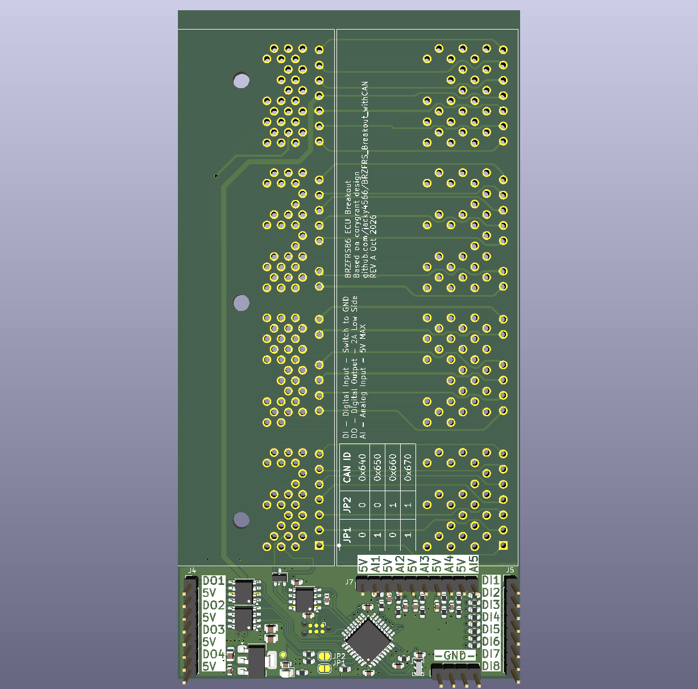

# BRZFRS_Breakout_withCAN

An inline ECU breakout board for the Subaru BRZ / Scion FR-S / Toyota 86 with a built-in CAN I/O module.

The board sits between your aftermarket ECU and the vehicle harness. All 135 ECU pins pass straight through. The board also taps the ECU's CAN bus and +5V supply to power a small STM32 module. That module reads extra analog and digital inputs, sends them on the CAN bus, and drives four low-side outputs on CAN command.

## Credits

The CAN I/O section is based on **[CANBoard](https://github.com/corygrant/CANBoard) by Cory Grant**, released under the MIT License (see [LICENSE.MD](LICENSE.MD)). This board adapts that design to the BRZ/FRS ECU connector form factor.

## Firmware

This board **requires Cory Grant's CANBoard firmware**. It does not work without it. Get the firmware, CAN message definitions and setup instructions from the original project:
https://github.com/corygrant/dingoFW

The MCU, CAN transceiver and I/O pin assignments come from the original CANBoard design. Refer to that project for the CAN message format and IDs.

### Programming

Flash the firmware over SWD with the **J1 Tag-Connect TC2030** footprint and an ST-Link (or another SWD probe) with a TC2030 cable.

## ECU connector taps

Every pin from J3 to J2 is wired 1:1. The CAN module connects to only these pins:

| ECU pin | Net | Use |
|--------:|-----|-----|
| A18 (18) | CAN_L | CAN bus low |
| A19 (19) | CAN_H | CAN bus high |
| D19 (120) | +5V | Powers the CAN module and the +5V pins on the headers |
| D29 (130) | GND | Signal ground |
| D03 (104), D04(105) | GNDPWR | Power ground for the output drivers |

The module runs from the ECU's +5V supply, so everything on the board and on the header +5V pins shares that supply. Keep the external load on the +5V pins small.

## Inputs

### Analog inputs: J7 (5 channels)

Each analog input has a 4.7k series resistor, a 10k resistor to ground and a 10nF filter capacitor before the STM32 ADC. The divider scales the input by about 0.68, so 3.3V at the ADC is about 4.85V at the pin.

Each input has a +5V pin next to it, so J7 can connect 3-wire sensors (signal, +5V, ground on J6) directly.

| J7 pin | Signal | MCU pin |
|-------:|--------|---------|
| 1 | +5V | |
| 2 | AI1 | PA0 |
| 3 | +5V | |
| 4 | AI2 | PA1 |
| 5 | +5V | |
| 6 | AI3 | PA2 |
| 7 | +5V | |
| 8 | AI4 | PA3 |
| 9 | +5V | |
| 10 | AI5 | PA4 |

### Digital inputs: J5 (8 channels)

Each digital input has a 10k series resistor to the MCU. There are no external pull-up or pull-down resistors. Input bias comes from the firmware's MCU pin configuration.

| J5 pin | Signal | MCU pin |
|-------:|--------|---------|
| 1 | DI1 | PA5 |
| 2 | DI2 | PA6 |
| 3 | DI3 | PA7 |
| 4 | DI4 | PB0 |
| 5 | DI5 | PB1 |
| 6 | DI6 | PA8 |
| 7 | DI7 | PA9 |
| 8 | DI8 | PA10 |

## Outputs

### Low-side outputs: J4 (4 channels)

The outputs use two NCV8402D dual low-side drivers. Each channel switches its pin to power ground (GNDPWR) and is rated for:

- 42V, 2A per channel
- Short-circuit protection
- Thermal shutdown with automatic restart
- Overvoltage protection
- Built-in clamp for inductive loads (relays, solenoids)

Connect the load between a positive supply and the DIGOUT pin. The supply can be the +5V pin beside each output (small 5V loads only) or switched 12V from the vehicle (relays, lamps, solenoids). The driver completes the circuit to ground when the output is on.

| J4 pin | Signal | MCU pin |
|-------:|--------|---------|
| 1 | DIGOUT1 | PA15 |
| 2 | +5V | |
| 3 | DIGOUT2 | PB3 |
| 4 | +5V | |
| 5 | DIGOUT3 | PB4 |
| 6 | +5V | |
| 7 | DIGOUT4 | PB5 |
| 8 | +5V | |

### Ground: J6

J6 pins 1 to 4 are all signal GND, for sensor and switch returns.

## CAN ID selection

Solder jumpers **JP1** (PB7) and **JP2** (PB6) select the module's CAN ID, as on the original CANBoard. Bridging a jumper (1) pulls its pin high through a 10k resistor.

| JP1 | JP2 | CAN ID |
|:---:|:---:|:------:|
| 0 | 0 | 0x640 |
| 1 | 0 | 0x650 |
| 0 | 1 | 0x660 |
| 1 | 1 | 0x670 |

See the [CANBoard firmware](https://github.com/corygrant/CANBoard) for the message layout at each ID.

## Repository contents

| File / folder | Description |
|---------------|-------------|
| `BRZ_Breakout_withCAN.kicad_pro` | KiCad project |
| `BRZ_Breakout_withCAN.kicad_sch` | Top-level schematic (ECU connectors and I/O headers) |
| `CANBoard.kicad_sch` | CAN module sub-sheet (MCU, CAN, power, I/O conditioning) |
| `BRZ_Breakout_withCAN.kicad_pcb` | PCB layout |
| `6376430-2/`, `Project.pretty/`, `*.kicad_sym` | Project symbols, footprints and 3D model for the ECU connector and NCV8402D |
| `bom/ibom.html` | Interactive BOM |

## License

MIT. See [LICENSE.MD](LICENSE.MD). The original CANBoard design is © 2023 Cory Grant.
